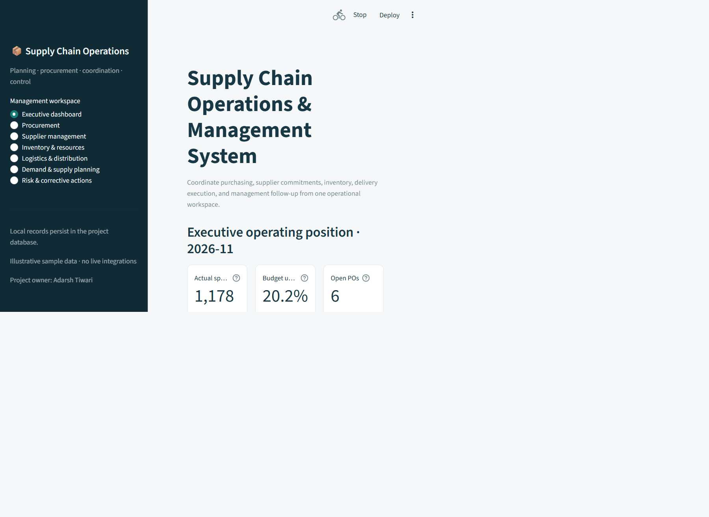
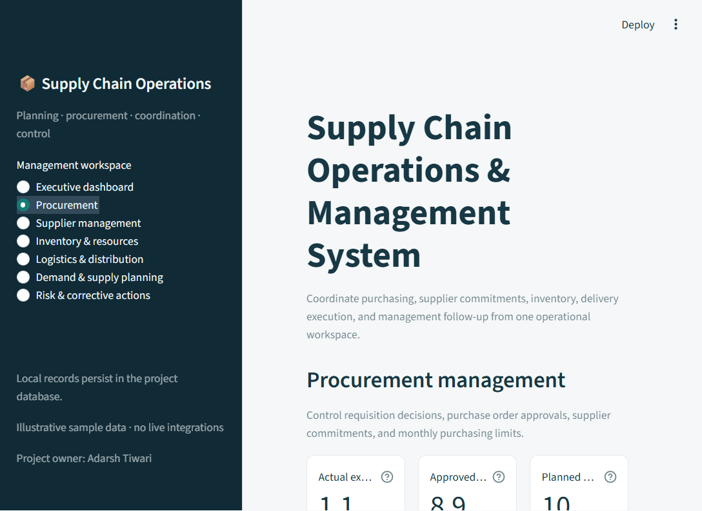
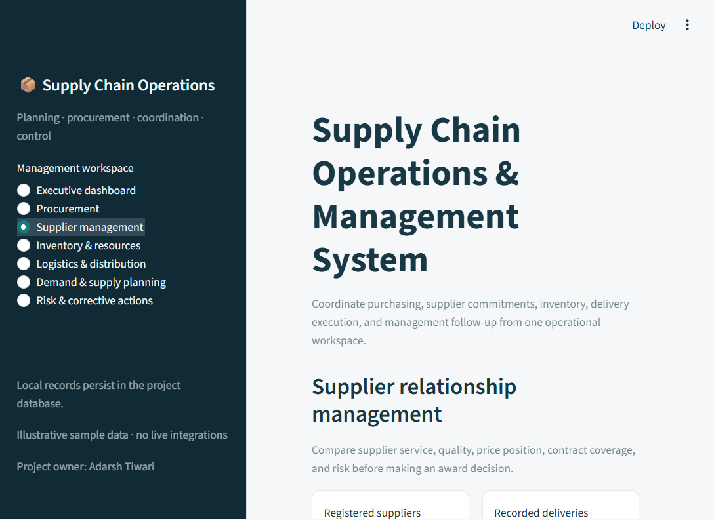
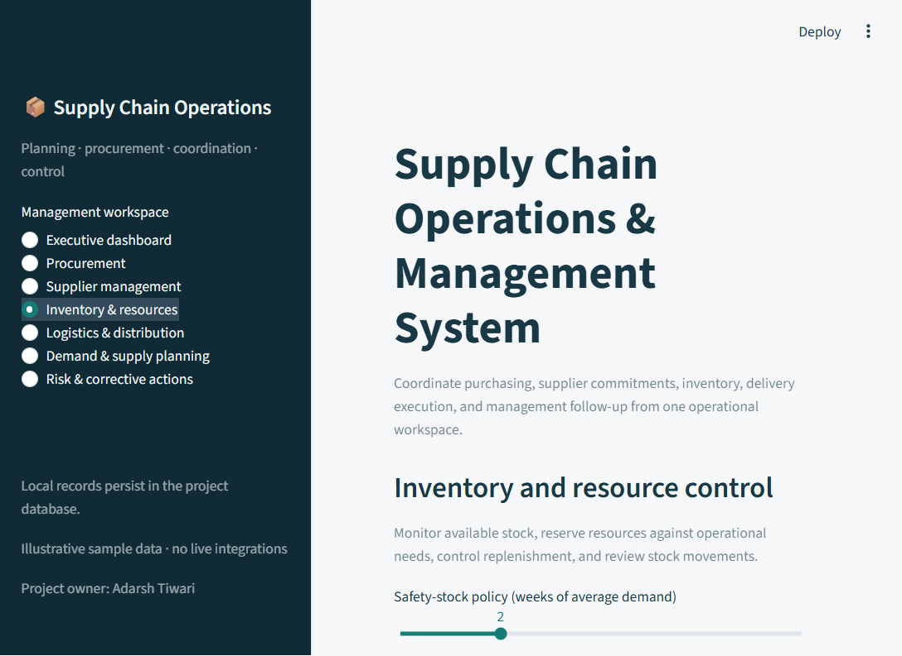
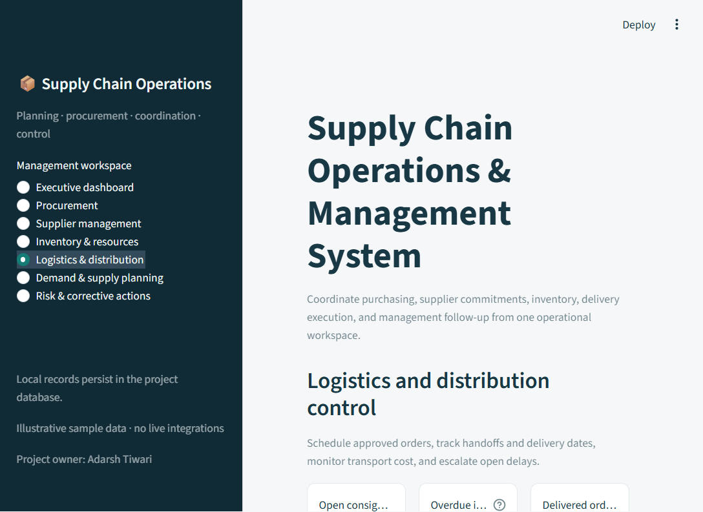
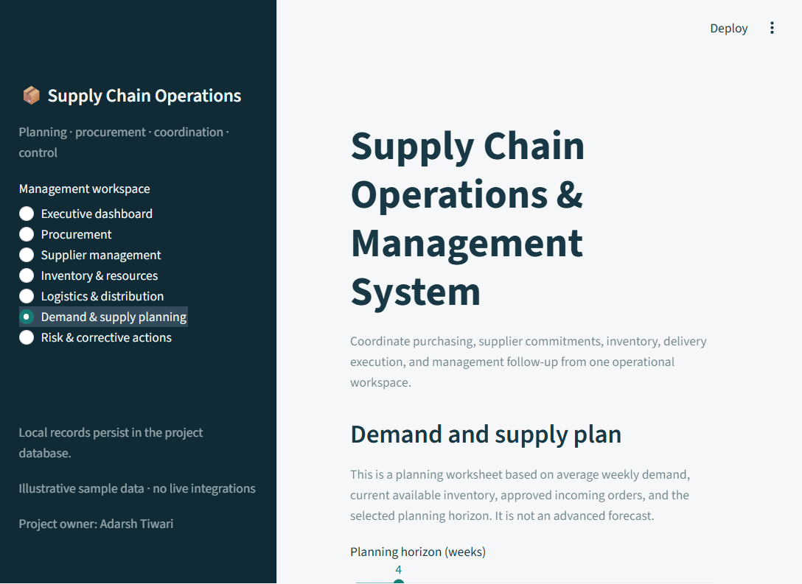
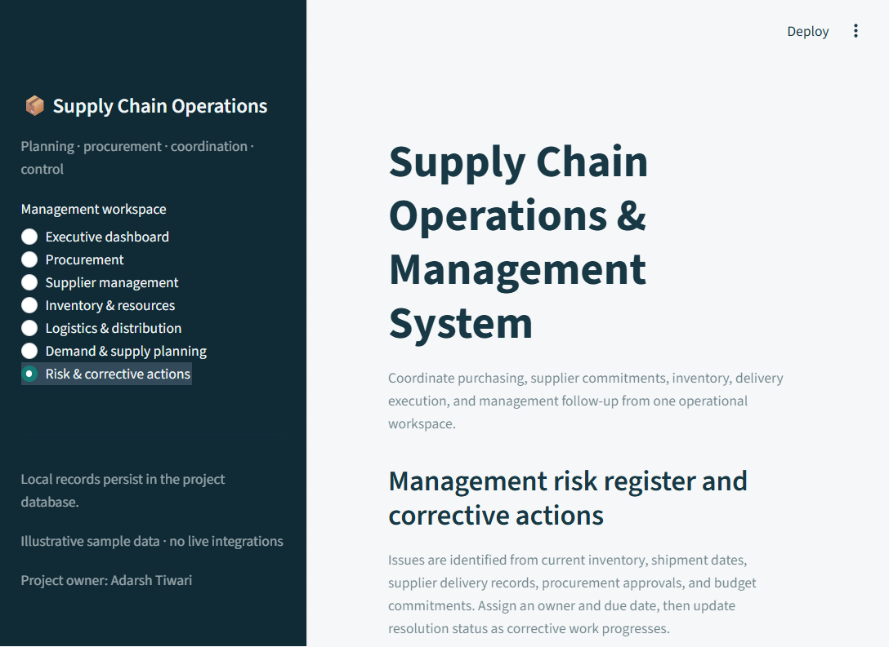

# Supply Chain Operations & Management System

A local, management-oriented workspace for coordinating procurement, suppliers,
inventory, resource allocation, inbound logistics, and operational follow-up.
It is designed to demonstrate practical supply-chain decision-making and
execution rather than software-development or data-analysis work.

**Project owner:** Adarsh Tiwari  
**GitHub:** [@adarshtiwari398](https://github.com/adarshtiwari398)

> All bundled suppliers, prices, budgets, stock records, shipments, and operating
> events are illustrative sample data. They are not actual business records.

## Management workspaces

- **Executive dashboard** — actual procurement spend, budget utilization,
  inventory value and turnover, supplier delivery performance, open orders,
  delayed shipments, stockout exposure, pending approvals, high-priority issues,
  and recent activity.
- **Procurement** — raise, edit, review, approve or reject requisitions; create
  and track purchase orders; convert approved requests into orders; record the
  budget; and compare planned commitments with actual received-order costs.
- **Supplier management** — register and maintain suppliers, contract details,
  risk classifications, quality and pricing assessments, delivery history, and
  a weighted supplier comparison scorecard with selection guidance.
- **Inventory & resources** — maintain stock records and minimum/maximum levels,
  review safety-stock and replenishment suggestions, identify shortages and
  overstock, allocate or consume resources, review stock movements, and import
  an inventory CSV.
- **Logistics & distribution** — schedule shipments against approved purchase
  orders, update shipment milestones, record transport costs and delay actions,
  and compare expected with actual delivery dates.
- **Demand & supply planning** — compare average weekly demand over a selected
  horizon with available stock and approved incoming orders, then review
  uncovered demand and future procurement requirements.
- **Risk & corrective actions** — review operational issues, their impact,
  priority, recommended action, owner, due date, and resolution status; create,
  assign, update, and close corrective actions. Issue detection is read-only;
  managers explicitly synchronize detected issues when they want action records
  created or refreshed.

## Screenshots / Application Preview

These screenshots are captured from the running local application and use
illustrative sample data.

### Executive Dashboard



### Procurement Management



### Supplier Scorecards



### Inventory Management



### Logistics and Distribution



### Demand and Supply Planning



### Risk and Corrective Actions



## How to run on Windows

1. Install Python 3.10 or newer from [python.org](https://www.python.org/downloads/).
   During installation, enable **Add Python to PATH**.
2. Double-click **Setup.bat** once. It creates a private environment in your
   Windows user profile and installs the app dependencies. Internet access is
   needed for this first-time step.
3. Double-click **Start.bat**. The system opens in your browser. Keep the
   command window open while you use it.
4. Close the command window to stop the app.

## Typical operating workflow

1. Review the executive dashboard for stock exposure, open approvals, shipment
   delays, supplier concerns, and budget position.
2. Submit a purchase requisition with the item, quantity, business reason,
   department, and need date.
3. A manager approves or rejects the requisition. An approved requisition can
   be converted to a pending purchase order and assigned to a supplier.
4. Review the order value and expected date. Approval is blocked if the
   purchase order's month has no budget record. Orders that would exceed an
   existing budget require a recorded override reason before approval.
5. Schedule an inbound shipment against an approved order. Update its status as
   it is prepared, dispatched, delayed, or delivered.
6. Marking a linked shipment delivered posts the receipt to on-hand inventory,
   records a stock movement, and completes the purchase order in one database
   transaction. Open incoming supply is not counted as received stock.
7. Review supplier delivery evidence, assign owners to operational issues, and
   record progress until each corrective action is resolved.

## Business calculation definitions

- **Actual procurement expenditure** is actual received quantity multiplied by
  actual unit cost for purchase orders delivered in the selected month.
- **Approved commitments** are the planned values of every approved,
  undelivered purchase order, regardless of when it was created.
  **Planned expenditure** equals selected-month actual expenditure plus all
  outstanding approved commitments. **Available budget** is the allocated
  budget less planned expenditure; a negative value indicates an overrun.
  **Budget utilization** is planned expenditure divided by the allocated
  monthly budget. Pending, rejected, and delivered orders are not commitments.
- A delivered order moves from outstanding commitments to actual expenditure
  in its delivery month, so it is never counted in both amounts. If no budget
  record exists for a purchase order's creation month, approval is blocked;
  an override reason cannot bypass a missing budget.
- **Inventory value** is current on-hand quantity multiplied by unit cost.
  Approved incoming orders are shown separately until delivery is recorded.
- **Supplier on-time delivery** is calculated from delivered shipment records
  with both expected and actual dates: on-time deliveries divided by recorded
  delivered shipments. Suppliers with no delivery history are identified as
  having limited evidence.
- **Supplier evaluation score** weights observed delivery reliability at 40%,
  the recorded quality assessment at 30%, the manager-entered pricing
  competitiveness assessment at 20%, and contract standing at 10%.
  Quality and pricing assessments are illustrative inputs, not external
  benchmarks.
- **Reorder point** compares the recorded minimum-stock floor with estimated
  lead-time demand plus the selected safety-stock allowance. Suggested
  quantities account for approved incoming supply.
- **Stockout risk** identifies products whose unallocated available stock is at
  or below estimated supplier lead-time demand. Resource allocations reduce
  available stock; consuming an allocation reduces on-hand stock and creates
  an issue movement.
- **90-day inventory turnover** is cost of goods issued divided by average
  inventory value at cost for the period. Average inventory value is estimated
  from opening and closing quantities at current recorded unit cost; opening
  quantities are reconstructed from the on-hand balance and recorded stock
  movements.
- **Delayed open shipments** are shipments whose expected date has passed
  without a recorded delivery, plus shipments explicitly marked delayed.
  Completed late deliveries inform supplier reliability but are not counted as
  open delayed shipments.
- **Demand estimates** use average weekly demand multiplied by the selected
  planning horizon. This is a simple planning estimate, not advanced
  forecasting.

## Inventory CSV format

Use **Inventory & resources → Import inventory** to import or update records.
Every file must include:

| Column | Meaning |
| --- | --- |
| `product_id` | Unique product or resource code |
| `product_name` | Product or resource name |
| `category` | Operational category |
| `supplier` | Name of a supplier already registered in the system |
| `on_hand` | Current physical quantity |
| `avg_weekly_demand` | Average units used or sold per week |
| `lead_time_days` | Standard supplier lead time in days |
| `unit_cost` | Unit cost in the currency used by your organization |

Numeric values must be finite and non-negative. Duplicate product IDs within
one file are reported as failed rows; identical existing records are skipped.
The import summary reports added, updated, skipped, and failed rows. Valid rows
are saved together in one database transaction. For existing products, the
import updates only the fields in this format and preserves configured minimum
stock, maximum stock, and carrying cost. New products receive calculated stock
levels and the default carrying-cost policy. On-hand quantity changes are
recorded as stock adjustments.

## Local data and record controls

- Operational records are stored in `data/supply_chain.db` (SQLite) and remain
  available after app refreshes and restarts.
- The illustrative CSVs in `data/` seed a new local database once. Reopening the
  app does not overwrite your subsequent changes.
- Opening an older database applies a corrective-action schema migration that
  preserves action records and permits a new action after a prior issue is
  resolved.
- Issue listings and dashboard refreshes do not write corrective-action rows.
  Use **Risk & corrective actions → Synchronize detected issues to action
  register** when management wants to create, reopen, or refresh action records.
  Resolution notes and assignment details are retained when descriptions are
  refreshed.
- Back up `data/supply_chain.db` before moving the project or making bulk
  changes. Do not share it if it contains confidential business information.
- Deletion is restricted when a record is linked to operational history.
  Completed procurement and delivered shipment records are retained for audit
  traceability; pending or rejected records can be deleted when unlinked.
- The application has no login, role-based access, or multi-user synchronization.
  Reviewer and owner fields are operational assignments, not authentication.

## Project files

```text
Adarsh-Supply-Chain-Control/
├── app.py                       # Management interface and workflows
├── management.py                # Business rules, KPIs, and record actions
├── database.py                  # Local SQLite schema and sample-data loading
├── operations.py                # Inventory validation and replenishment rules
├── data/                        # Illustrative seed records
├── tests/                       # Calculation and workflow tests
├── screenshots/                 # Captures of the running application
├── .streamlit/config.toml       # Enterprise-style light theme
├── Setup.bat                    # One-time Windows setup
├── Start.bat                    # Start the local application
└── requirements.txt             # Streamlit, Pandas, and Plotly
```

## Verify the business rules

After running **Setup.bat**, open PowerShell in this folder and run:

```text
%LOCALAPPDATA%\AdarshSupplyChainControl\.venv\Scripts\python.exe -m unittest discover -s tests -v
```

For a manual setup in PowerShell:

```powershell
python -m venv .venv
.\.venv\Scripts\python.exe -m pip install -r requirements.txt
.\.venv\Scripts\python.exe -m streamlit run app.py
.\.venv\Scripts\python.exe -m unittest discover -s tests -v
```

The test suite uses Python's built-in `unittest`; no separate test framework
dependency is required.

## Scope and limitations

This is a local planning and control application, not an ERP, accounting
system, live supplier portal, or carrier integration. No live data is fetched.
Each purchase order is represented by one full-order shipment; partial receipts,
multi-user approvals, authentication, tax, foreign-exchange conversion, and
accounting-ledger posting are not implemented. Review all planning outputs
against current business records, supplier terms, and purchasing policy before
committing funds.

The project has no login or role-based authorization; reviewer and budget
override fields record the operator's stated role but do not verify identity.
The supplied source folder contains no license file, and redistribution rights
could not be verified. No license has been added; confirm permissions before
redistributing the project with any parent-source materials.
